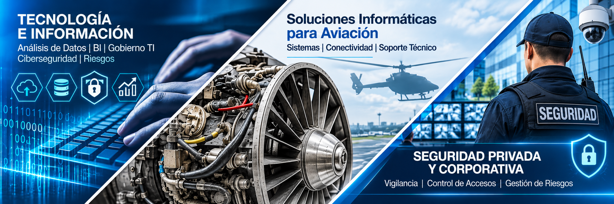

<!-- SECCIÓN 1: ENCABEZADO Y BANNER (HTML para centrar) -->

  <h1>Hola, soy Juan David Villada 👋</h1>

  <!-- Banner de Trayectoria Profesional -->
  

  <h3>Ingeniero Informático en formación | Analista de Datos | Técnico en Mantenimiento Aeronáutico (TMA) & Coordinador de Operaciones</h3>

  

    De la precisión en el mantenimiento aeronáutico, centrales de monitoreo y seguridad corporativa, 
    a la arquitectura de datos, automatización de procesos y desarrollo de software.
  

  <!-- Insignias de contacto (Badges) -->
  

    
    
  

<!-- SECCIÓN 2: PERFIL OPERATIVO Y TRAYECTORIA (Markdown) -->
## 🚁 Del Mantenimiento Aeronáutico y Operaciones Críticas en Seguridad Privada y Corporativa a los Datos

Mi perfil combina más de dos décadas de disciplina operativa en entornos de alta exigencia con formación en **Ingeniería Informática (9.º semestre)** y **Analítica de Datos Empresariales**. Aplico la misma mentalidad de control de riesgos, trazabilidad y respuesta en tiempo real al desarrollo de software y la ciencia de datos:

- 💎 **Seguridad Corporativa & Trazabilidad (Actual):** *Supervisor de Material Esmeraldífero*, encargado de la custodia de activos críticos, auditoría en campo y cumplimiento de protocolos de seguridad minera.
- 📡 **Seguridad Electrónica & Monitoreo 24/7:** *Jefe de Turno y Coordinador de Operaciones en Telesentinel*, dirigiendo la central receptora de señales de alarma, atención de emergencias y despacho táctico de supervisores motorizados.
- 📋 **Logística & Planeación Operativa:** *Programador de Turnos en Seguridad Privada*, optimizando la asignación de talento humano y garantizando la continuidad operativa sin brechas de cobertura.
- ✈️ **Aviación Militar & Mantenimiento (20+ años):** Suboficial, *Técnico en Mantenimiento Aeronáutico (TMA)* de helicópteros MI-17 y *Jefe de Tripulación* (1,438+ horas de vuelo) en el Ejército Nacional de Colombia.

- 🔭 **Enfoque tecnológico:** Analítica de datos aplicada a seguridad y GRC (Gobierno, Riesgo y Cumplimiento), evaluación de indicadores de gestión y riesgo (KPI/KRI), automatización de procesos. 
- 📍 **Ubicación:** Bogotá, Colombia.

---

<!-- SECCIÓN 3: STACK TECNOLÓGICO (HTML + Shields.io para orden visual) -->
## ⚙️ Herramientas y Tecnologías

  
  **Análisis de Datos & BI**  
  
  
  
  
  

    

  **Desarrollo, Automatización & Gestión**  
  
  
  
  
  

---

<!-- SECCIÓN 4: PROYECTOS DESTACADOS (Tabla Markdown) -->
## 📂 Proyectos Destacados

| Proyecto | Descripción | Tecnologías |
| :--- | :--- | :--- |
| **Análisis de Tráfico Móvil en Colombia** | Exploración de métricas de tráfico de voz, internet e ingresos utilizando datasets públicos de CRC Postdata. | `Python` `Pandas` `Matplotlib` `Seaborn` |
| **Automatización de Minutas Operativas** | Flujo automatizado para el registro de novedades de seguridad mediante dictado por voz y tableros de control. | `Google Forms` `Make` `Trello` `Notion` |
| **Gestión de Datos - Banco de Alimentos** | Proyecto de práctica profesional enfocado en optimización y análisis de información operativa. | `Excel` `Análisis de Datos` |

---

<!-- SECCIÓN 5: ESTADÍSTICAS DE GITHUB (HTML centrado) -->
## 📊 Métricas de Actividad

  
  

